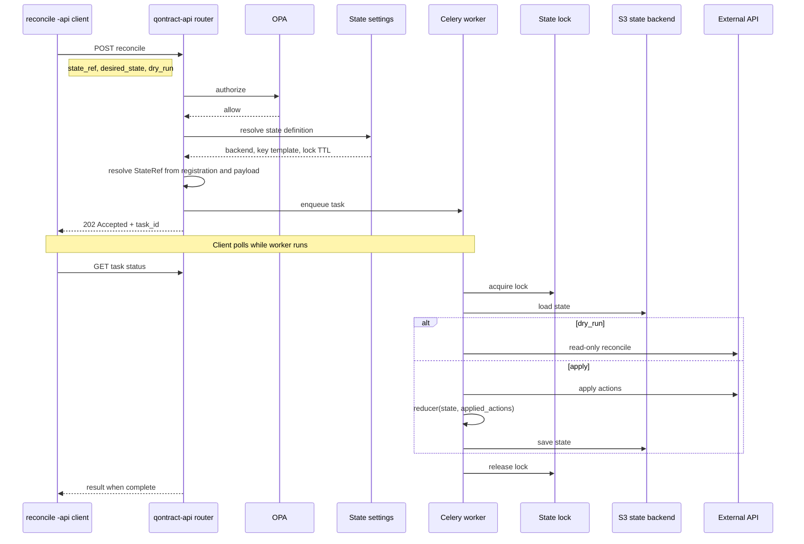

# ADR-022: Stateful qontract-api Integrations

**Status:** Proposed
**Date:** 2026-10-29
**Authors:** a-sinclaire
**Supersedes:** N/A
**Superseded by:** N/A

## Context

Some qontract-api integrations must reconcile against an external system that has **no list-all API** (or equivalent). The integration still needs **durable persisted state** (for example a managed-key set) so create/update/delete diffs stay correct across runs.

`ldap-groups-api` ([APPSRE-13597](https://issues.redhat.com/browse/APPSRE-13597)) is the **first** qontract-api integration with this requirement. Review on [PR #5846](https://github.com/app-sre/qontract-reconcile/pull/5846) explored **client-owned** S3 state (`managed_groups`, client-side task recovery). That splits ownership with qontract-api and complicates cutover (separate `ldap-groups-api` vs legacy `ldap-groups` keys).

Reviewers proposed moving durable state to qontract-api with a **generic** pattern reusable by later migrations ([APPSRE-12896](https://issues.redhat.com/browse/APPSRE-12896)). See [PR #5846 comment](https://github.com/app-sre/qontract-reconcile/pull/5846#issuecomment-6333155181).

### Constraints

- External HTTP to Internal Groups (and peers) stays in qontract-api per ADR-013.
- Integration layout stays ADR-014 (L1 utils, L2 workspace client, L3 router/service/tasks).
- New HTTP `operation_id`s require OPA when policies are enabled (ADR-021).
- Legacy rollback for ldap-groups depends on `state/ldap-groups/managed_groups` remaining authoritative during cutover.
- **Cutover:** While server-owned integration state is active for a StateRef, the legacy integration (ADR-007 / ADR-008 feature flag) must not write the same S3 object. Cutover docs disable legacy jobs before `-api` owns the state; only the StateStore path writes under the per-StateRef lock.
- **Rollback:** Re-enable legacy only after the `-api` integration is disabled and in-flight qontract-api tasks for that StateRef have finished; integration doc documents drain steps.
- **Reconcile sharding:** Multiple reconcile `-api` deployments may run in parallel (app-interface `sharding`). StateStore behavior is chosen per integration (below).
    - **Global state (default for flat managed sets):** One integration-wide StateRef maps to one S3 object holding the full managed set. Each task loads the full state under the StateRef lock, applies this run’s slice, reduces **applied actions** into the full set, and saves. Parallel POSTs serialize on the lock.
    - **Partitioned state (when the integration doc selects it):** Registration includes a partition field name (`shard_by` in `state_ref`; client does not send partition values). qontract-api derives values from desired state, resolves one StateRef and S3 key per value, and locks per ref. Use a stable field in the payload (not static reconcile shard id). Reject or fan out mixed partition values in one request (e.g. ldap-groups may partition by group id prefix or `namespace/name`-style keys when the integration doc enables partitioned mode).

## Decision

Adopt a **server-owned integration state** model for qontract-api integrations that need durable state between runs:

1. **Client contract:** Reconcile `-api` integrations send **`state_ref`**, **desired state**, and **`dry_run`** only; persisted integration state lives on the server (no client state I/O).
2. **StateRef:** Each integration registers a fixed server-side reference mapped to a stable persistence key (typically an S3 object path). **Default for greenfield integrations:** `state/<integration>-api/...`. Map StateRef to a **legacy S3 key** only when cutover or rollback requires that object (e.g. `ldap-groups.managed_groups` → `state/ldap-groups/managed_groups` for ldap-groups).
3. **StateStore:** qontract-api provides load/save with a **per-StateRef lock** so only one worker mutates a given state's persistence at a time. Locks use a bounded lease; **save** runs only while the holder still owns the lock (renewal, stale-holder recovery, and fencing are defined in StateStore implementation). External API mutations started under a lock must not commit after the worker loses the lease; StateStore defines how in-flight calls are cancelled, ignored, or generation-checked (implementation detail).
4. **Worker flow:** On task execution: acquire lock → load persisted state → reconcile external API using the loaded state as the current managed set → **reduce** only **applied** actions into new state → save (skip save on dry-run) → release lock. When `dry_run` is true, skip external mutations; **applied actions** are empty and persisted state is unchanged.
5. **Reducer:** Each integration defines a pure function `(old_state, applied_actions) → new_state`. **Applied actions** are those that succeeded against the external API in that run when `dry_run` is false. Transitions depend on that integration's action model and state schema (a sorted managed-key set is a common shape; see **Implementation Guidelines**).
6. **Crash safety:** Use two-phase state updates when a crash mid-task could confuse the next run. **Creates:** update persisted state **before** the external create (next run re-checks before creating again). **Deletes:** update persisted state **after** the external delete succeeds. **Updates:** no special ordering unless the integration doc says otherwise. Integration docs define pending-state or idempotent lookup for create recovery and state cleanup when delete succeeded but save failed. Document crash recovery in the integration doc (see **Implementation Guidelines**).

### Registration and ownership

**Registration:** Each state is registered by `(integration, state_name)` with schema/type, reducer, backend, persistence key template, lock TTL/lease policy, optional partition fields, and permitted reconcile endpoints.

**Ownership:** The reconcile `-api` client owns desired state and sends only `state_ref` plus payload; qontract-api owns the registered definition, persisted state, backend credentials, lock, reducer, and load/save. Endpoints reject unregistered or cross-integration `state_ref` values. **Endpoint binding:** registration lookup before enqueue is the source of truth for which `state_ref` values each reconcile HTTP endpoint accepts; OPA authorizes integration access (ADR-021) but does not replace registration binding.

### End-to-end reconcile flow

Illustrates Decision items 1–4 and registration and ownership: one stateful reconcile POST from the `-api` client through router enqueue, worker lock, state load/save, and external reconcile. Client result retrieval follows ADR-003 (POST returns a task id; client polls GET for completion).

**Boundaries** (read against the sequence):

- **Client:** `state_ref`, desired state, and `dry_run` only; not backend credentials or server-resolved persistence keys.
- **qontract-api (router):** resolves the registered state definition from `state_ref` and payload, rejects `state_ref` not registered for this integration, authorizes (OPA when enabled), resolves credentials, enqueues a task with a concrete StateRef.
- **Worker:** per-StateRef lock spans load → reconcile → reduce → save.

### Key Points

- **Server-owned state:** qontract-api loads, updates, and saves integration state.
- **One writer per StateRef:** A per-StateRef lock covers load → reconcile → reduce → save so concurrent workers cannot corrupt the same persisted state.
- **Applied actions only:** New persisted state is produced only from actions that actually succeeded in that run (integration-specific reducer).

## Alternatives Considered

### Alternative 1: Client-owned state (reconcile `-api` client)

The reconcile client loads and saves integration state in S3, sends managed resource keys with desired state, and handles async task recovery on the client.

**Pros:**

- Does not require new qontract-api platform work (StateStore, locks, registration).
- Reuses existing reconcile `State` patterns.

**Cons:**

- Two owners for the same logical state during cutover.
- Extra client complexity (recovery polling, stale task refs, dual S3 keys).
- Each new stateful integration may copy the same client-side machinery.

### Alternative 2: No durable state (full discovery each run)

Reconcile derives current managed resources from the external API on every run without persisted state.

**Pros:**

- No integration state object in S3.

**Cons:**

- Requires a list-all API or equivalent full discovery each run (see Context).

### Alternative 3: Server-owned StateStore and reducer (Selected)

qontract-api owns integration state: StateRef registration, StateStore load/save, per-StateRef locking, and an integration reducer over **applied** actions. Reconcile `-api` clients send `state_ref`, desired state, and `dry_run` only.

**Pros:**

- Single owner and one persistence path per integration state.
- Reusable platform pattern for later APPSRE-12896 migrations.
- Legacy S3 keys can remain canonical where rollback requires it.
- Crash-safe state update rules live with the worker that mutates external systems.

**Cons:**

- Requires new qontract-api components (StateStore, locks, registration).
- Lock contention if many workers hit the same store infrastructure.
  - **Mitigation:** Per-StateRef locks; monitor lock duration and queue depth.

## Consequences

### Positive

- **Simpler clients:** Reconcile `-api` jobs send `state_ref`, desired state, and `dry_run` only.
- **One platform pattern:** Later stateful migrations reuse StateStore.
- **One place to look:** Persisted state lives in qontract-api; cutover docs name the StateRef and S3 key.
- **Crash rules with the worker:** State update ordering runs in the Celery task that calls the external API.

### Negative

- **More platform to run:** StateStore, locks, and registration are owned and operated like other qontract-api infrastructure.
- **Per-integration design:** Each integration documents its state shape, reducer, and which operations need two-phase updates.
- **Concurrency limits:** Heavy load on one StateRef can queue Celery workers behind the per-StateRef lock.

## Implementation Guidelines

### When to use this pattern

- Integration needs durable state that **cannot** be derived from a full list API on each run.
- State must survive process restarts and be consistent under concurrent Celery workers.

### When not to use

- Ephemeral, reconstructible state with no durable persistence requirement.
- Typical CRUD integrations where desired state is complete each run (list APIs).

### Checklist

- [ ] Register each state by `(integration, state_name)` → persistence key; document mapping, global vs partitioned layout, and permitted endpoints in the integration doc.
- [ ] **Celery task:** lock → load state → pass loaded state into L3 reconcile → reconcile → reduce → save; skip save when `dry_run` is true; on dry-run, applied actions are empty and persisted state is unchanged.
- [ ] **L3 service** returns **applied actions** from reconcile (ADR-014); reducer is pure over `(state, applied_actions)`.
- [ ] Document two-phase state rules for crash-sensitive operations, if any (Decision item 6).
- [ ] Add or change routes/models, then regenerate OpenAPI and `qontract_api_client` (do not hand-edit generated files).
- [ ] Add OPA policies for new `operation_id`s (ADR-021).
- [ ] Tests cover reducer logic and dry-run.
- [ ] **reconcile `-api` client (ADR-008):** `reconcile/<integration>_api.py`, GraphQL desired state (ADR-002), POST `state_ref`, desired payload, and `dry_run`, poll task status (ADR-003).
- [ ] **Integration doc:** StateRef → key, rollback, cutover (legacy job off and in-flight task drain before shared key), crash recovery and two-phase rules (Decision item 6).
- [ ] **StateStore implementation:** lock lease, stale-holder rejection on save, bounds on external mutations after lease expiry, queued-task ordering per StateRef (FIFO or reject stale generation), tests for concurrent workers and expired lock holders.

## References

- Related: [ADR-002](ADR-002-client-side-graphql-fetching.md) - Client-side GraphQL fetching
- Related: [ADR-003](ADR-003-async-only-api-with-blocking-get.md) - Async tasks and blocking GET for status
- Related: [ADR-007](ADR-007-no-reconcile-changes-migrate-utils.md) - Legacy integration unchanged for rollback
- Related: [ADR-008](ADR-008-qontract-api-client-integration-pattern.md) - Reconcile `*_api` client integrations
- Related: [ADR-013](ADR-013-centralize-external-api-calls.md) - External API calls via qontract-api
- Related: [ADR-014](ADR-014-three-layer-architecture-for-external-apis.md) - L1/L2/L3 layout
- Related: [ADR-021](ADR-021-opa-authorization.md) - OPA authorization
- Design discussion: [PR #5846 comment](https://github.com/app-sre/qontract-reconcile/pull/5846#issuecomment-6333155181)
- PR: [app-sre/qontract-reconcile#5846](https://github.com/app-sre/qontract-reconcile/pull/5846)
